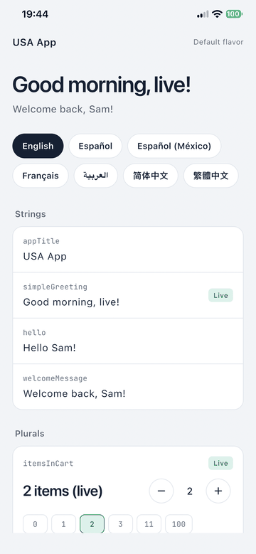
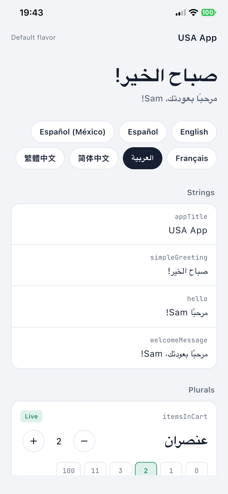
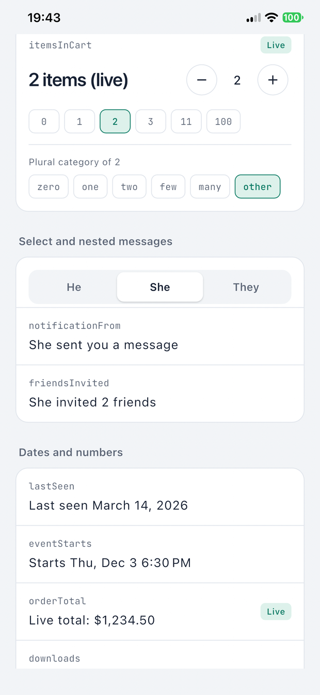
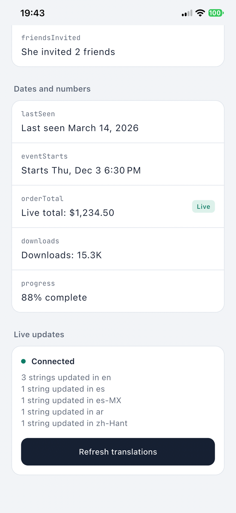

# Flutter Localisation

[](https://pub.dev/packages/flutter_localisation)
[](https://pub.dev/packages/flutter_localisation/score)
[](https://pub.dev/packages/flutter_localisation/score)
[](./LICENSE)

Type-safe Flutter localization from your ARB files, with live translation
updates. Fix a typo or reword a screen from the
[flutterlocalisation.com](https://flutterlocalisation.com) dashboard and your
users see it on the next refresh, without a store release.

- `context.tr.hello('Sam')`: generated, typed methods for every key.
- Plurals with every category (`zero`, `one`, `two`, `few`, `many`), `select`,
  nested messages, dates, currencies and compact numbers.
- Flavors: one ARB folder per brand or environment.
- Live updates render exactly like the bundled string, fall back to it when
  offline, and are cached on the device.
- Works offline and for free with local ARB files. Live updates and the
  dashboard are optional.

<table>
  <tr>
    <td></td>
    <td></td>
    <td></td>
    <td></td>
  </tr>
</table>

The [example app](./example): seven languages, right to left Arabic, every
message type, and strings marked **Live** where an update replaced the bundled
copy.

> Native iOS app with an Xcode String Catalog? The same live updates are in
> [flutter_localisation_ios](https://github.com/tajaouart/flutter_localisation_ios).

## Install

```yaml
dependencies:
  flutter_localisation: ^2.7.0
  flutter_localizations:
    sdk: flutter
  intl: any

flutter:
  generate: true
```

And the code generator:

```bash
dart pub global activate flutter_localisation
```

## Quick start

### 1. Put your ARB files in a flavor folder

```
arbs/
  production/
    app_en.arb
    app_es.arb
  staging/
    app_en.arb
```

Write them by hand, or let the dashboard push them to your Git repository
(GitHub, GitLab or Bitbucket) and clone that repository as `arbs/`.

### 2. Generate the code

```bash
flutter_localisation arbs production
```

This pulls the folder if it is a Git repository, runs `gen-l10n`, writes
`lib/generated_translation_methods.dart` and refreshes the analyzer cache.
Restart the app afterwards: hot reload does not pick up regenerated code.

### 3. Wire it up

```dart
import 'package:flutter/material.dart';
import 'package:flutter_localizations/flutter_localizations.dart';
import 'package:flutter_localisation/flutter_localisation.dart';

import 'generated_translation_methods.dart';
import 'localization/generated/app_localizations.dart';

final translations = TranslationService(
  config: TranslationConfig.freeUser(),
);

Future<void> main() async {
  WidgetsFlutterBinding.ensureInitialized();
  await translations.initialize();
  runApp(const MyApp());
}

class MyApp extends StatelessWidget {
  const MyApp({super.key});

  @override
  Widget build(BuildContext context) {
    return MaterialApp(
      localizationsDelegates: const [
        AppLocalizations.delegate,
        GlobalMaterialLocalizations.delegate,
        GlobalWidgetsLocalizations.delegate,
        GlobalCupertinoLocalizations.delegate,
      ],
      supportedLocales: AppLocalizations.supportedLocales,
      home: Builder(
        builder: (context) => TranslationProvider(
          service: translations,
          generatedLocalizations: AppLocalizations.of(context),
          child: const HomePage(),
        ),
      ),
    );
  }
}
```

### 4. Use it

```dart
Text(context.tr.hello('Sam'));
Text(context.tr.itemsInCart(3));
Text(context.tr.notificationFrom('female'));
Text(context.tr.lastSeen(DateTime.now()));
```

## Live updates

Live updates come with a paid plan on
[flutterlocalisation.com](https://flutterlocalisation.com). Copy the live update
key (`sk_live_...`) from the Live updates page and the project id from the
project settings:

```dart
final translations = TranslationService(
  config: TranslationConfig(
    secretKey: const String.fromEnvironment('FL_SECRET_KEY'),
    projectId: 42,
    flavorName: 'production',
    supportedLocales: ['en', 'es', 'es-MX', 'ar'],
    backgroundCheckInterval: const Duration(minutes: 30),
  ),
);
```

`initialize()` loads the cached updates and fetches new ones in the
background. Edit a string in the dashboard, publish a live update, and call
`context.translations?.refresh()` (or wait for the next check) to show it.

How an update is applied:

- It goes through the same ICU rules as `flutter gen-l10n`, so plurals,
  `select`, nested messages and placeholder formats come out the same as the
  bundled string.
- A key the update does not carry keeps the bundled string. On an `es-MX`
  device a live `es-MX` string wins, then the bundled `es-MX` one, then a live
  `es` string.
- When a new release ships ARBs newer than the cached updates, the cache is
  cleared, so the release never shows stale copy.
- A malformed string falls back to the bundled one instead of showing raw ICU.

Keep the key out of source control: pass it with
`--dart-define=FL_SECRET_KEY=...` as the example does.

## Message types

```json
{
  "hello": "Hello {name}!",
  "itemsInCart": "{count, plural, =0{No items} =1{1 item} other{{count} items}}",
  "notificationFrom": "{gender, select, male{He sent you a message} female{She sent you a message} other{They sent you a message}}",
  "orderTotal": "Total: {amount}",
  "@orderTotal": {
    "placeholders": {
      "amount": {"type": "double", "format": "simpleCurrency", "optionalParameters": {"name": "USD"}}
    }
  }
}
```

Every plural category your languages use works, including Arabic `two`, `few`
and `many`. Placeholder `type`, `format`, `optionalParameters` and
`isCustomDateFormat` are read from the template ARB and applied to live
strings too.

## Flavors

One folder per flavor, generated with the same command:

```bash
flutter_localisation arbs staging
flutter_localisation arbs production
```

Pass the matching `flavorName` to `TranslationConfig` so live updates come from
the right flavor.

## The dashboard

[](https://flutterlocalisation.com)

- Edit keys with your team, with roles per project and flavor.
- AI translation and translation memory.
- Two way Git sync of the ARB files.
- Live updates, published per flavor.

Free tools, no signup:
[ARB Editor](https://flutterlocalisation.com/tools/arb-editor),
[ARB Diff](https://flutterlocalisation.com/tools/arb-diff),
[l10n.yaml Generator](https://flutterlocalisation.com/tools/l10n-yaml-generator),
[Locale Explorer](https://flutterlocalisation.com/tools/flutter-locale-explorer).

| | Free | Starter | Growth | Business |
| --- | --- | --- | --- | --- |
| Projects | 2 | 6 | 20 | Unlimited |
| Translation keys | 500 | 15,000 | 75,000 | 300,000 |
| Team members | 3 | 8 | 25 | 100 |
| Live updates | | ✓ | ✓ | ✓ |
| Git sync and AI translation | ✓ | ✓ | ✓ | ✓ |

Limits count unique keys, not keys times languages, so adding a language is
free on every plan. Starter is 29 EUR a month or 249 EUR a year; see
[pricing](https://flutterlocalisation.com/#pricing). Businesses can pay by
invoice and bank transfer.

## From the terminal and coding agents

The companion
[`flutter_localisation_cli`](https://pub.dev/packages/flutter_localisation_cli)
package adds, edits and translates keys from the shell (pure Dart, no Flutter
SDK needed):

```bash
dart pub global activate flutter_localisation_cli

fl login --token flk_live_xxx          # token from the dashboard, API Keys
fl add greeting --value "Hello" -t     # add and translate to every locale
fl languages add fr de it -t           # add locales and fill every key
fl pull                                # sync the ARBs into arb_dir
```

It also ships an MCP server (`fl_mcp`) and an agent skill:

```bash
npx skills add tajaouart/flutter_localisation_cli --skill flutter-localisation
```

## Example app

```bash
cd example
flutter_localisation arbs usa
flutter run
# with live updates:
flutter run --dart-define=FL_SECRET_KEY=sk_live_... --dart-define=FL_PROJECT_ID=42
```

English, Spanish, Mexican Spanish, French, Arabic, Simplified and Traditional
Chinese; two flavors (`usa`, `mexico`); plurals, `select`, nested messages,
dates and numbers; and a live update panel.

## API

| | |
| --- | --- |
| `context.tr` | The generated translator. |
| `context.translations` | The `TranslationService` above the widget. |
| `initialize()` | Load cached updates and fetch new ones. |
| `refresh()` | Fetch now. |
| `hasOverride(locale, key)`, `getOverride(locale, key)` | What a live update set. |
| `getAllOverridesForLocale(locale)`, `getCacheStatus()` | Live strings per locale. |
| `clearCache()` | Drop live strings and show the bundled ones. |

## Troubleshooting

**Generated code is missing or stale.** Run
`flutter_localisation arbs <flavor>` again and fully restart the app. Check
that `flutter: generate: true` is in `pubspec.yaml` and the files are named
`app_<locale>.arb`.

**Live updates do not show.** Check the key starts with `sk_live_`, the
project id and flavor match the dashboard, and the plan includes live
updates. On Android, release builds need
`<uses-permission android:name="android.permission.INTERNET"/>` in the main
manifest. Logs are on by default (`enableLogging`).

**A key is missing from `context.tr`.** A key named like a
`Translator` member (`refresh`, `translate`) is hidden; the generator warns
about it.

## Links

- [Issues](https://github.com/tajaouart/flutter_localisation/issues)
- [flutterlocalisation.com](https://flutterlocalisation.com)

MIT licensed.
