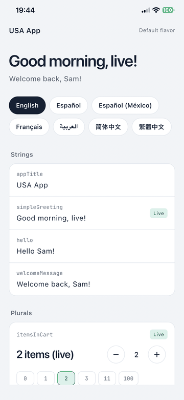

# flutter_localisation example

A one screen app that shows every message type the package handles, in seven
languages: English, Spanish, Mexican Spanish, French, Arabic (right to left),
Simplified and Traditional Chinese.



- Strings with placeholders, plurals with every category, `select` and nested
  messages, dates, currency, compact numbers and percentages.
- Two flavors, `arbs/usa` and `arbs/mexico`.
- A live update panel: strings replaced by an update are marked **Live**.

## Run

```bash
flutter_localisation arbs usa
flutter run
```

With live updates from your [flutterlocalisation.com](https://flutterlocalisation.com)
project:

```bash
flutter run --dart-define=FL_SECRET_KEY=sk_live_... --dart-define=FL_PROJECT_ID=42 --dart-define=FL_FLAVOR=Default
```

Keep the key out of source control. Without it the app runs on the bundled
ARBs only.
